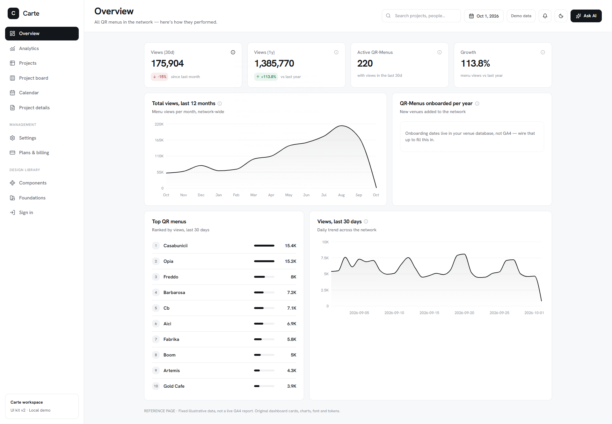

# Carte design kit

A reusable dashboard design system with two complete implementations: an offline HTML demo and a native Next.js starter. Both include the same 11 page templates, charts, cards, tables, forms, board, calendar, settings and interactive states.



## Choose a version

| Folder | Best starting point | Run |
|---|---|---|
| [`html/`](html/) | Visual reference, offline demo, or adapting the design to PHP, Laravel, Django and other stacks | Open `html/design-system.html` in a browser |
| [`nextjs/`](nextjs/) | A new React / Next.js application with native routes and editable components | `cd nextjs`, `npm ci`, `npm run dev` |

### HTML demo

Download or clone this repository and open `html/design-system.html`. Keep its `assets/` folder and stylesheets alongside the file. No installation or external services are needed to view it.

For a local HTTP preview with consistent browser storage:

```sh
node html/serve.cjs
```

Open `http://127.0.0.1:4174`. For source edits and rebuild instructions, see [the HTML README](html/README.md).

### Next.js starter

Requires Node.js 20.9 or newer.

```sh
cd nextjs
npm ci
npm run dev
```

Open the URL printed by Next.js. For production builds, tests, architecture and extension points, see [the Next.js README](nextjs/README.md).

## Included pages

Overview, analytics, projects table, project details, board, calendar, settings, billing, component gallery, foundations and sign-in. Interactions include search, filters, sorting, selection, pagination, CSV downloads, local create/edit/delete, calendar events, task checks, theme switching, dialogs, drawers, toasts and validation.

The visual system uses local Hanken Grotesk fonts, cool grays, flat bordered cards, a 264px sidebar, 1280px content canvas and 16px grid gaps. Original chart components and design tokens are included in both versions.

## Use with an LLM

For Next.js work, give your coding assistant the `nextjs/` source and [its reuse prompt](nextjs/REUSE-PROMPT.md). For another stack, use the `html/` demo, [design specification](html/DESIGN-SYSTEM.md), [reuse prompt](html/REUSE-PROMPT.md) and plain-HTML example.

Ask it to reuse the supplied components and measurements directly, then replace the product domain and data bindings. Keep the reference page for visual regression checks.

## Demo data and verification

This repository contains presentation source and illustrative data. No GA4 service account, model API key, database, authentication service or payment processor is required. Sign-in, billing, file selection, message composition and Ask AI are explicitly labeled demo interactions. Saved demo records stay in browser storage.

The October 2026 package verification included production build/typecheck and 25 browser acceptance checks for the Next.js starter. Its overview content canvas matched the bundled HTML reference with zero changed pixels at the recorded desktop configuration. These are historical results with their scope and screenshots in [Next.js verification](nextjs/verification/README.md); they do not promise parity after future edits.

Font and bundled dependency notices are retained in each implementation's `licenses/` folder.
